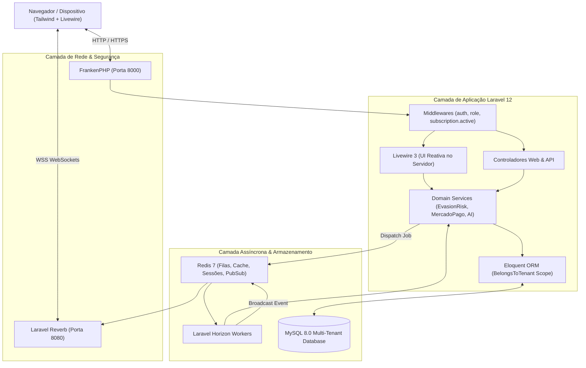
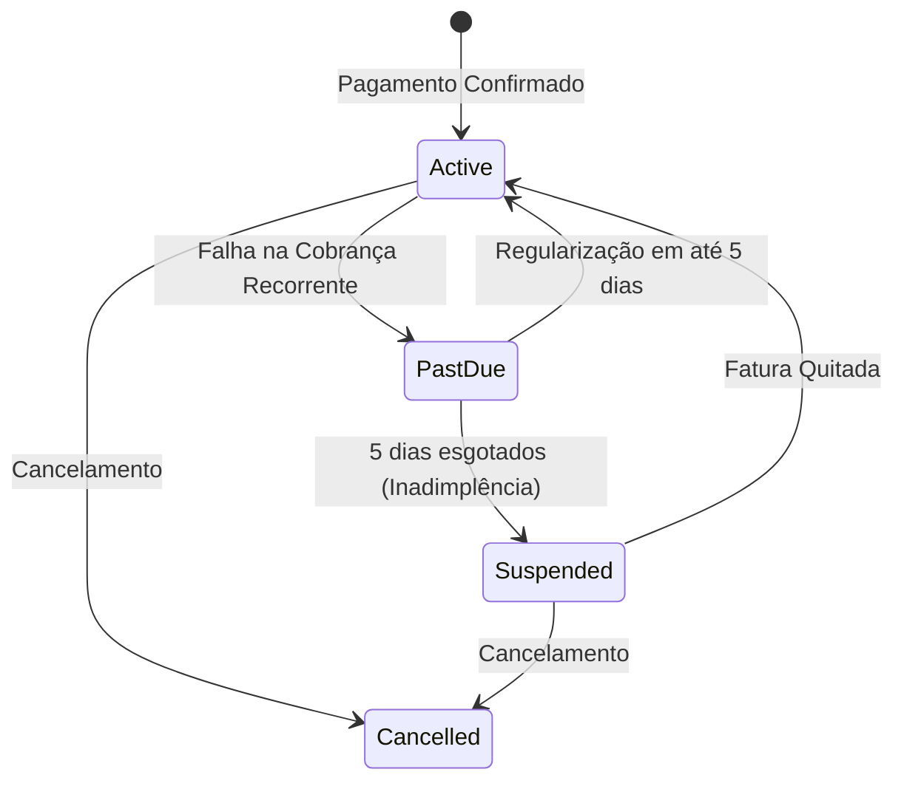

# Arquitetura do Sistema — ALVORA

**Mapeamento da Base de Código: Outubro de 2026**

---

## 🏛️ Filosofia: Monolito Modular de Alta Concorrência

O **ALVORA** é arquitetado como um **Monolito Modular** em Laravel 12 rodando sobre **Laravel Octane com FrankenPHP**. 

A aplicação rejeita a complexidade operacional precoce de microsserviços em favor de um sistema coeso que oferece:
1. **Transações Atômicas:** Garantia ACID nativa no MySQL para operações financeiras, matrículas e concessão de certificados.
2. **Separação por Contextos Delimitados:** Módulos lógicos (`Admin`, `Company`, `Instructor`, `Student`, `AI`, `Billing`).
3. **Execução em Memória:** FrankenPHP e Octane eliminam o overhead de boot do framework a cada request HTTP.

---

## 🏢 1. Arquitetura Multi-Tenant: Single Database com Segregação Lógica

O sistema atende múltiplos clientes corporativos compartilhando um único banco de dados relacional (MySQL 8.0), garantindo isolamento através de regras de software nativas do ORM Eloquent.

### A. Trait [`BelongsToTenant`](file:///c:/Users/Windows%20Lite%20BR/alvora/app/Traits/BelongsToTenant.php)
Todos os models vinculados a uma empresa implementam este trait:
1. **Injeção de Escopo Global:** Aplica automaticamente o [`TenantScope`](file:///c:/Users/Windows%20Lite%20BR/alvora/app/Models/Scopes/TenantScope.php) em todas as queries (`SELECT`), adicionando `WHERE company_id = {user.company_id}`.
2. **Gravação Segura:** No evento `creating`, preenche automaticamente o campo `company_id` com o id da empresa do usuário logado, impedindo a injeção acidental ou maliciosa de IDs de outros tenants.

### B. Bypass de Super Admin
Usuários com o papel `admin_alvora` têm isenção no `TenantScope`, permitindo visualização consolidada entre empresas para auditoria, suporte e métricas globais de MRR.

---

## 👥 2. Modelo de Autorização e Matriz de Papéis (RBAC)

O controle de acesso é regulado pelo enum [`App\Enums\UserRole`](file:///c:/Users/Windows%20Lite%20BR/alvora/app/Enums/UserRole.php) e pelo middleware [`EnsureUserHasRole`](file:///c:/Users/Windows%20Lite%20BR/alvora/app/Http/Middleware/EnsureUserHasRole.php):

| Papel | Escopo | Capacidades Principais |
| :--- | :--- | :--- |
| `admin_alvora` | **Global (Super Admin)** | Faturamento global, monitoramento do Horizon, acesso unificado a todos os tenants. |
| `company_admin` | **Tenant (RH / Diretoria)** | Sala de Situação em tempo real, gestão de colaboradores, atribuição de trilhas, faturamento da empresa. |
| `instructor` | **Tenant (Pedagógico)** | Gestão de cursos, módulos, aulas, upload de materiais, quizzes e gerador de ementas por IA. |
| `student` | **Tenant (Colaborador)** | Dashboard de estudos, player de aulas, interação com Tutor IA, quizzes e emissão de certificados. |

---

## ⏳ 3. Ciclo de Vida da Assinatura e Middleware Gatekeeper

O middleware [`CheckSubscriptionStatus`](file:///c:/Users/Windows%20Lite%20BR/alvora/app/Http/Middleware/CheckSubscriptionStatus.php) atua como barreira de proteção do faturamento B2B:

* **Período de Carência (5 dias):** Empresas com pagamento pendente entram em `past_due`. Os colaboradores continuam assistindo aulas para não interromper programas de treinamento corporativo.
* **Suspensão:**
  - Gestores de RH/Instrutores são redirecionados compulsoriamente para `/instrutor/faturamento`.
  - Alunos têm o acesso a aulas e chamadas de IA bloqueados com mensagem explicativa para contatar o RH.

---

## 🧠 4. Motor Anti-Evasão com IA Preditiva

Diferente de sistemas que registram o abandono tardiamente, o ALVORA calcula o risco continuamente antes da desistência do aluno.

### Algoritmo Matemático de Risco:
$$\text{Score Total} = (0.35 \times I) + (0.25 \times E) + (0.20 \times Q) + (0.20 \times D)$$

1. **Inatividade ($I$ - 35%):** Dias corridos sem autenticação (0 a 14+ dias escalonados até 100 pontos).
2. **Estagnação ($E$ - 25%):** Dias sem registro de conclusão de aulas em `lesson_progress`.
3. **Desempenho em Quizzes ($Q$ - 20%):** Dificuldade calculada como $\max(0, 100 - \text{Média das Notas})$.
4. **Desvio de Pares ($D$ - 20%):** Atraso de ritmo relativo à média do departamento na mesma empresa.

### Fluxo Reativo em Cascata:
1. Conclusão de aula ou quiz dispara `CalculateEvasionRiskJob::dispatch($userId)`.
2. O worker do Horizon calcula e persiste o score na tabela `risk_scores` com o payload JSON auditável de breakdown.
3. Se o score atingir **Zona Crítica (Score ≥ 70)**:
   - Dispara `EvasionRiskAlertEvent` via broadcast WebSocket para a **Sala de Situação** do RH.
   - O serviço `EvasionInterventionService` é acionado para gerar uma mensagem personalizada via OpenRouter e sugerir a próxima lição ao colaborador.

---

## 📜 5. Módulo de Certificação e Auditoria

1. **Elegibilidade Rígida:** Conclusão de 100% das aulas ativas do curso via [`CertificateService`](file:///c:/Users/Windows%20Lite%20BR/alvora/app/Services/CertificateService.php).
2. **Código de Autenticidade Único:** Gerado no formato `ALV-2026-XXXXXX` com UUID global.
3. **Renderização de PDF:** DomPDF em folha A4 formato paisagem com layout institucional.
4. **Endpoint Público de Verificação:** `/validar-certificado/{code}` permite a recrutadores e empresas auditarem a legitimidade do certificado sem necessidade de login.
