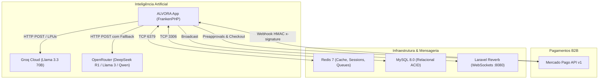

# Integrações e Serviços Externos — ALVORA

**Mapeamento da Base de Código: Outubro de 2026**

---

## 🌐 Visão Geral de Comunicação Externa

O ALVORA integra serviços de nuvem para prover inteligência artificial generativa, processamento de pagamentos recorrentes B2B, emissão criptográfica de certificados e monitoramento em tempo real.

---

## 🤖 1. Serviços de Inteligência Artificial

### A. Groq API (Chat de Baixa Latência)
* **Classe:** [`App\Services\GroqAiService`](file:///c:/Users/Windows%20Lite%20BR/alvora/app/Services/GroqAiService.php)
* **Configuração:** `config/ai.php` (`ai.groq`)
* **Endpoint:** `https://api.groq.com/openai/v1/chat/completions`
* **Modelo Padrão:** `llama-3.3-70b-versatile`
* **Timeout:** 8 segundos
* **Casos de Uso:** Tutor virtual do aluno no player de vídeo (`AiTutorDrawer.php`), respondendo dúvidas contextuais da aula com tempo de resposta sub-1.5s.
* **Degradação Elegante:** Se a chave `GROQ_API_KEY` não for informada no ambiente, o serviço entra em modo simulado sem quebrar a tela do aluno.

### B. OpenRouter API (Motor Analítico Resiliente em Cascata)
* **Classe:** [`App\Services\OpenRouterResilientService`](file:///c:/Users/Windows%20Lite%20BR/alvora/app/Services/OpenRouterResilientService.php)
* **Configuração:** `config/ai.php` (`ai.openrouter`)
* **Endpoint:** `https://openrouter.ai/api/v1/chat/completions`
* **Cascata de Fallback:**
  1. `deepseek/deepseek-r1:free` (Raciocínio lógico e estruturação de cursos)
  2. `meta-llama/llama-3.3-70b-instruct:free` (Intervenções persuasivas e JSONs estritos)
  3. `qwen/qwen3-235b-a22b:free` (Garantia de disponibilidade)
* **Mecanismo:** Em caso de `429 Too Many Requests`, `5xx` ou timeout, o serviço avança automaticamente para o próximo modelo da lista sem propagar exceção para o usuário.
* **Casos de Uso:**
  - Geração de matriz curricular a partir de tópicos (`CurriculumAiGenerator.php`).
  - Geração de mensagens de acolhimento e incentivo para colaboradores em risco alto de evasão (`EvasionInterventionService.php`).
  - Relatórios qualitativos e diagnósticos de engajamento para RH e diretoria (`AiExecutiveInsights.php`).

---

## 💳 2. Gateway de Pagamento: Mercado Pago

* **Classe:** [`App\Services\MercadoPagoService`](file:///c:/Users/Windows%20Lite%20BR/alvora/app/Services/MercadoPagoService.php)
* **Controlador de Retorno:** [`App\Http\Controllers\BillingReturnController`](file:///c:/Users/Windows%20Lite%20BR/alvora/app/Http/Controllers/BillingReturnController.php)
* **Controlador de Webhook:** [`App\Http\Controllers\Api\MercadoPagoWebhookController`](file:///c:/Users/Windows%20Lite%20BR/alvora/app/Http/Controllers/Api/MercadoPagoWebhookController.php)
* **Endpoint de Notificação:** `POST /api/webhooks/mercadopago`
* **Assinatura Criptográfica:**
  - O cabeçalho `x-signature` contém `ts` e hash `v1`.
  - O hash HMAC-SHA256 é calculado contra a chave `MERCADO_PAGO_WEBHOOK_SECRET`.
  - Requisições não assinadas ou adulteradas são abortadas com `HTTP 401 Unauthorized`.
* **Endpoints da API Mercado Pago Utilizados:**
  - `POST /preapproval`: Criação de contratos de débito recorrente.
  - `GET /preapproval/{id}`: Consulta do estado da assinatura.
  - `PUT /preapproval/{id}`: Pausa ou cancelamento de assinatura.
  - `POST /checkout/preferences`: Criação de links de pagamento para faturas avulsas e adesão inicial.

---

## 📡 3. Mensageria em Tempo Real & Filas

### Laravel Reverb (WebSockets)
* **Porta:** `8080` (HTTP/WSS)
* **Protocolo:** Compatível com o cliente Pusher e Laravel Echo.
* **Canais Privados de Transmissão:**
  - `company.{companyId}`: Exclusivo para diretores e gestores de RH da respectiva empresa (alertas da Sala de Situação).
  - `user.{userId}`: Exclusivo para o colaborador (mensagens de apoio e intervenções).
* **Eventos Broadcast:**
  - `App\Events\EvasionRiskAlertEvent`: Disparado quando o Score de Evasão cruza o limiar crítico (≥ 70).
  - `App\Events\NewInterventionDispatchedEvent`: Disparado quando uma ação de retenção é enviada ao aluno.

### Laravel Horizon (Gerenciamento de Filas)
* **Backend:** Redis 7 (`redis:6379`)
* **Job Principal:** [`App\Jobs\CalculateEvasionRiskJob`](file:///c:/Users/Windows%20Lite%20BR/alvora/app/Jobs/CalculateEvasionRiskJob.php)
* **Painel Administrativo:** `/horizon` (Restrito a `admin_alvora`)

---

## 🩺 4. Observabilidade & Sonda de Saúde

### Endpoint de Sonda: `GET /api/health`
* **Controlador:** [`App\Http\Controllers\Api\HealthCheckController`](file:///c:/Users/Windows%20Lite%20BR/alvora/app/Http/Controllers/Api/HealthCheckController.php)
* **Serviço:** [`App\Services\HealthCheckService`](file:///c:/Users/Windows%20Lite%20BR/alvora/app/Services/HealthCheckService.php)
* **Componentes Verificados:**
  1. **MySQL 8.0:** Executa `SELECT 1` com medição de latência em milissegundos.
  2. **Redis 7:** Executa comando `PING` com medição de latência.
  3. **Sistema de Arquivos:** Checa permissão de escrita e espaço livre em disco em `storage/` (> 500MB).
* **Retorno:** `HTTP 200` com status individual ou `HTTP 503` em caso de degradação crítica.

---

## 📜 5. Módulo de Certificação e DomPDF

* **Serviço:** [`App\Services\CertificateService`](file:///c:/Users/Windows%20Lite%20BR/alvora/app/Services/CertificateService.php)
* **Controlador:** [`App\Http\Controllers\CertificateController`](file:///c:/Users/Windows%20Lite%20BR/alvora/app/Http/Controllers/CertificateController.php)
* **Emissão em PDF:** DomPDF compilando a view Blade [`resources/views/certificates/template.blade.php`](file:///c:/Users/Windows%20Lite%20BR/alvora/resources/views/certificates/template.blade.php) em modo Paisagem A4.
* **Validação Pública:** Rota aberta `GET /validar-certificado/{code}` que autentica a legitimidade da emissão através do código alfanumérico e UUID.
