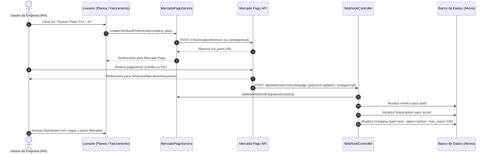

# Phase 05: Faturamento e Assinaturas B2B com Mercado Pago - Research

**Researched:** 2026-10-20
**Domain:** Monetização B2B, Mercado Pago Subscriptions API (Preapproval), Checkout Pro e Webhooks
**Confidence:** HIGH

<user_constraints>
## User Constraints (from CONTEXT.md)

### Locked Decisions
- **D-01 (Modalidade de Checkout):** Checkout Pro (Redirect Seguro) com URLs de retorno (`back_urls`) configuradas para a Alvora (`/empresa/faturamento/sucesso`, `/empresa/faturamento/pendente`, `/empresa/faturamento/erro`). Elimina manipulação de dados de cartão na aplicação (PCI compliance) e garante suporte a Pix, Boleto e Cartão corporativo.
- **D-02 (Recorrência Híbrida):** Assinatura Automática no Cartão de Crédito via Preapproval API do Mercado Pago + Faturamento sob demanda no Checkout Pro a cada ciclo de 30 dias para pagamentos via Pix ou Boleto.
- **D-03 (Inadimplência e Carência):** Tolerância de 5 dias corridos após notificação de atraso/falha (`status = overdue`). Colaboradores mantêm acesso com banner persistente para o gestor (`company_admin`). Após 5 dias sem regularização, a empresa é suspensa (`status = suspended`), bloqueando alunos e restringindo o gestor exclusivamente à tela de faturamento.
- **D-04 (Regras de Upgrade):** Upgrade com cobrança integral e novo ciclo de 30 dias. O plano anterior é cancelado no Mercado Pago, cobra-se o valor cheio do novo plano e reinicia-se a vigência a partir do pagamento confirmado.

### the agent's Discretion
- Modelagem detalhada das tabelas `subscriptions` e `invoices` vinculadas a `companies`.
- Implementação do serviço `MercadoPagoService` utilizando o cliente HTTP nativo do Laravel (`Http::baseUrl(...)`) ou o SDK oficial `mercadopago/dx-php` v3.
- Mecanismo seguro de validação de assinatura `x-signature` do webhook do Mercado Pago.
- Estruturação dos componentes Livewire das telas de faturamento do gestor (`/empresa/faturamento`) e super admin (`/admin/faturamento`) respeitando o contrato de design [05-UI-SPEC.md](.planning/phases/05-faturamento-e-assinaturas-b2b-com-mercado-pago/05-UI-SPEC.md).

### Deferred Ideas (OUT OF SCOPE)
- Emissão automatizada de Nota Fiscal de Serviço eletrônica (NFS-e).
- Parcelamento de anuidade com desconto em 12x no cartão corporativo.
</user_constraints>

<architectural_responsibility_map>
## Architectural Responsibility Map

| Capability | Primary Tier | Secondary Tier | Rationale |
|------------|-------------|----------------|-----------|
| Geração de Preferência de Checkout Pro | API/Backend (`MercadoPagoService`) | Database | Monta payload com preço do plano, dados da empresa contratante e URLs de callback |
| Assinatura Recorrente no Cartão (Preapproval) | API/Backend (`MercadoPagoService`) | Database | Cria e gerencia assinaturas no endpoint `/preapproval` do Mercado Pago |
| Ingestão e Validação de Webhooks | API/Backend (`WebhookController`) | Database | Recebe eventos `payment` e `subscription_preapproval`, valida `x-signature` e atualiza status |
| Verificação de Acesso e Carência | Middleware / Model (`Company`) | Livewire | Avalia se a empresa está `active`, em carência (`overdue`) ou bloqueada (`suspended`) |
| Gestão de Faturamento do RH | Livewire (`CompanyBilling`) | Blade / Tailwind | Exibe status da assinatura, cota de colaboradores, histórico de faturas e botão de upgrade |
| Painel Global de Faturamento B2B | Livewire (`AdminBilling`) | Blade / Tailwind | Apresenta métricas de MRR, total de empresas assinantes e tabela de auditoria de webhooks |
</architectural_responsibility_map>

<research_summary>
## Summary

A integração da Fase 5 estabelece a infraestrutura financeira B2B da Alvora integrando o ecossistema do **Mercado Pago**. A arquitetura adota uma abordagem híbrida: assinaturas no cartão corporativo utilizam a **Preapproval API** (débito recorrente automatizado), enquanto empresas que preferem quitar faturas via Pix ou Boleto utilizam o **Checkout Pro** com cobrança por ciclo de 30 dias.

Para comunicação com a API do Mercado Pago, a melhor prática em Laravel 12 consiste em isolar as chamadas em um serviço dedicado (`App\Services\MercadoPagoService`). Utilizar o client HTTP nativo do Laravel (`Illuminate\Support\Facades\Http`) configurado com token Bearer e baseUrl `https://api.mercadopago.com` proporciona máxima testabilidade com `Http::fake()`, retries exponenciais automáticos e independência de dependências de terceiros, podendo coexistir com o SDK oficial `mercadopago/dx-php` v3 caso necessário.

Os webhooks do Mercado Pago disparam notificações com headers `x-signature` e `x-request-id`. A validação criptográfica (HMAC-SHA256) impede forjamento de eventos de pagamento. Uma vez validada a confirmação do pagamento, a empresa é ativada ou sua carência é redefinida para ativa, liberando imediatamente o limite de colaboradores contratado.

**Primary recommendation:** Criar um `MercadoPagoService` encapsulando a criação de preferências de Checkout Pro e Preapproval, acompanhado de migrations para `subscriptions` e `invoices`, com middleware de verificação de status (`EnsureCompanySubscriptionActive`) e componentes Livewire para o gestor e super admin.
</research_summary>

<standard_stack>
## Standard Stack

### Core
| Library / Component | Version | Purpose | Why Standard |
|---------------------|---------|---------|--------------|
| `Illuminate\Support\Facades\Http` | Laravel 12 Core | Comunicação REST com a API do Mercado Pago | Nativo, robusto, suporte completo a `Http::fake()`, timeouts e retries |
| `mercadopago/dx-php` | ^3.16 (opcional) | SDK oficial Mercado Pago | Suporte de tipos para payloads de Checkout Pro e Preapproval |
| `Livewire 3` | ^4.4 / Livewire 3 | Componentes reativos de UI | Padrão monolítico do projeto para painéis de RH e Admin |
| `TailwindCSS` | v4 | Estilização das telas de faturamento | Alinhado com os tokens definidos em `05-UI-SPEC.md` |

### Supporting
| Component | Purpose | When to Use |
|-----------|---------|-------------|
| `App\Services\MercadoPagoService` | Gateway Service | Centraliza criação de preferências, consultas de pagamento e assinaturas |
| `App\Http\Controllers\WebhookController` | Endpoint de Webhook | Trata `POST /api/webhooks/mercadopago` de forma idempotente |
| `App\Http\Middleware\CheckSubscriptionStatus` | Controle de Acesso | Bloqueia alunos se a empresa estiver com status `suspended` |

### Configuration (`config/services.php`)
```php
'mercadopago' => [
    'access_token' => env('MERCADO_PAGO_ACCESS_TOKEN'),
    'public_key'   => env('MERCADO_PAGO_PUBLIC_KEY'),
    'webhook_secret' => env('MERCADO_PAGO_WEBHOOK_SECRET'),
],
```
</standard_stack>

<architecture_patterns>
## Architecture Patterns

### Data Flow Diagram



### Database Schema Design

#### 1. Migração `subscriptions`
```php
Schema::create('subscriptions', function (Blueprint $table) {
    $table->id();
    $table->foreignId('company_id')->constrained()->cascadeOnDelete();
    $table->string('mp_preapproval_id')->nullable()->index();
    $table->string('plan'); // starter, pro, enterprise
    $table->string('status'); // pending, active, overdue, suspended, cancelled
    $table->decimal('amount', 10, 2);
    $table->string('billing_cycle')->default('monthly');
    $table->timestamp('current_period_start')->nullable();
    $table->timestamp('current_period_end')->nullable();
    $table->timestamp('grace_period_ends_at')->nullable();
    $table->timestamp('cancelled_at')->nullable();
    $table->timestamps();
});
```

#### 2. Migração `invoices`
```php
Schema::create('invoices', function (Blueprint $table) {
    $table->id();
    $table->foreignId('company_id')->constrained()->cascadeOnDelete();
    $table->foreignId('subscription_id')->nullable()->constrained()->nullOnDelete();
    $table->string('mp_payment_id')->nullable()->unique();
    $table->string('mp_preference_id')->nullable()->index();
    $table->decimal('amount', 10, 2);
    $table->string('payment_method')->nullable(); // credit_card, pix, boleto
    $table->string('status')->default('pending'); // pending, paid, failed, refunded
    $table->timestamp('paid_at')->nullable();
    $table->string('receipt_url')->nullable();
    $table->timestamps();
});
```

### Validação de Assinatura do Webhook

O Mercado Pago inclui o header `x-signature` no formato:
`ts=1710000000,v1=hash_gerado`

Algoritmo de validação:
1. Extrair `ts` e `v1` do header `x-signature`.
2. Extrair o ID do recurso dos query parameters (`data.id` ou `id`).
3. Construir a manifest string: `id:[data.id];request-id:[x-request-id];ts:[ts];`.
4. Calcular o HMAC-SHA256 usando o `webhook_secret` da aplicação.
5. Comparar com `hash_equals($calculatedHash, $v1)`.
6. Consultar a API do Mercado Pago via `GET /v1/payments/{id}` para confirmar o status real do pagamento.
</architecture_patterns>

<testing_strategy>
## Testing Strategy

1. **Testes Unitários:**
   - `MercadoPagoServiceTest`: Validação de montagem do payload do Checkout Pro, cálculo de vigência de 30 dias e algoritmo de checagem do `x-signature`.
2. **Testes de Integração de Webhook:**
   - `WebhookTest`: Simulação de payload de `payment.created` com status `approved` ativando a empresa.
   - Simulação de evento de falha (`payment.rejected`) acionando o status de carência de 5 dias (`overdue`).
   - Simulação de expiração de carência gerando suspensão da empresa (`suspended`).
3. **Testes de Middleware e Controle de Acesso:**
   - `SubscriptionAccessTest`: Garantir que alunos de empresas com status `suspended` recebem HTTP 403 ou redirecionamento amigável, enquanto o `company_admin` tem acesso garantido à tela `/empresa/faturamento`.
4. **Testes de Componentes Livewire:**
   - `CompanyBillingTest`: Renderização do status do plano, barra de vagas de colaboradores e histórico de faturas.
   - `AdminBillingTest`: Renderização de métricas de MRR e empresas assinantes.
</testing_strategy>

---
*Phase: 05-Faturamento e Assinaturas B2B com Mercado Pago*
*Research completed: 2026-10-20*
