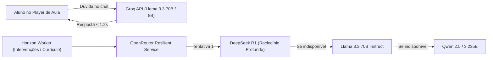

# 01. Visão Geral e Stack Tecnológica

## 🏛️ Filosofia Arquitetural: Monolito Modular

O **ALVORA** foi concebido sob a arquitetura de **Monolito Modular** em Laravel 12. Em vez de introduzir a complexidade operacional e latência de rede de microsserviços distribuídos precocemente, o sistema consolida todas as capacidades de negócio em uma única base de código coesa, fortemente tipada e dividida em domínios lógicos bem delimitados.

### Principais Vantagens Desta Abordagem
* **Velocidade de Desenvolvimento:** Rápida iteração de novas funcionalidades sem duplicação de boilerplate de autenticação, migrações ou barramentos de mensageria complexos.
* **Transações Atômicas:** Garantia ACID nativa no banco de dados para operações críticas (ex.: matrículas, faturamento e concessão de certificados).
* **Manutenibilidade:** Domínios claros (`Company`, `Instructor`, `Student`, `AI`, `Billing`) com limites de contexto bem definidos.
* **Escalabilidade Vertical e Horizontal:** Suporte a Laravel Octane (FrankenPHP) para concorrência de altíssimo desempenho em memória e divisão de workers via Horizon.

---

## 🛠️ Stack Tecnológica Completa

| Camada | Tecnologia | Versão | Função Principal |
| :--- | :--- | :--- | :--- |
| **Linguagem Backend** | PHP | 8.3 | Tipagem estrita, performance otimizada com JIT e novos recursos de sintaxe. |
| **Framework Web** | Laravel | 12.x | Núcleo do ecossistema, ORM Eloquent, DI Container, filas, roteamento e autenticação. |
| **Camada Reativa** | Livewire | 3.x | Componentização de interface dinâmica do lado do servidor sem necessidade de SPA complexo. |
| **Estilização** | Tailwind CSS & Vite | 3.x / 6.x | Design system utilitário moderno, responsivo e compilação rápida de assets com HMR. |
| **Banco de Dados Principal** | MySQL | 8.0 | Armazenamento relacional ACID com índices compostos para isolamento multi-tenant. |
| **Cache, Filas & Sessão** | Redis | 7-alpine | In-memory store para sessões, locks distribuídos, cache e backend de filas assíncronas. |
| **Gerenciador de Filas** | Laravel Horizon | 5.x | Painel e supervisão em tempo real de background jobs (recalculo de score de evasão, webhooks). |
| **WebSockets em Tempo Real**| Laravel Reverb | 1.x | Servidor de mensageria em tempo real protocolo Pusher para a Sala de Situação do RH. |
| **Servidor de Alta Performance** | Laravel Octane + FrankenPHP | Latest | Execução contínua da aplicação em memória sem reiniciar o ciclo de vida do PHP a cada request. |
| **Emissão de Documentos** | DomPDF / Barryvdh | 3.x | Geração de certificados em PDF com vetores, estilos personalizados e metadados. |
| **Testes Automatizados** | PHPUnit | 11.x | Suíte completa de testes de unidade e integração (Feature/Unit). |
| **Containerização** | Docker & Docker Compose | Multi-stage | Orquestração reproduzível com 5 serviços interdependentes e health checks. |

---

## 🤖 Ecossistema de Inteligência Artificial

A plataforma adota uma abordagem de IA de duplo motor (Dual-Engine AI Architecture):

1. **Motor de Baixa Latência (Edge/Groq):** Dedicado ao **Tutor IA** dentro da sala de aula. Utiliza a infraestrutura de LPUs da Groq para fornecer respostas em tempo real (< 1.5s), permitindo um diálogo fluido sem quebrar o fluxo de estudo do colaborador.
2. **Motor Resiliente em Cascata (OpenRouter):** Dedicado a tarefas assíncronas e analíticas pesadas:
   - Diagnósticos qualitativos de engajamento para a diretoria.
   - Geração de mensagens persuasivas de intervenção preditiva.
   - Geração autônoma de ementas curriculares estruturadas em JSON.
   - **Fallback Dinâmico:** Se um modelo free ou rate limit falhar, o serviço chaveia transparentemente para o próximo provedor da lista sem lançar erro fatal ao usuário.
