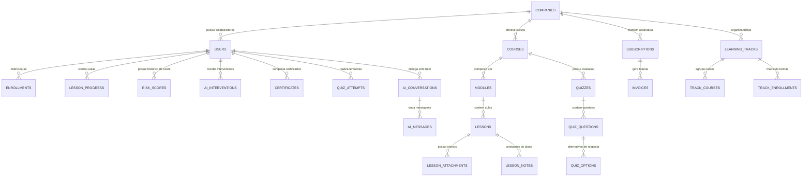

# 03. Banco de Dados e Modelagem Relacional

## 🗄️ Esquema de Entidades e Relacionamentos (ERD)

O banco de dados do ALVORA foi desenhado com integridade referencial forte em MySQL 8.0, dividindo as entidades em 6 grandes grupos funcionais:

---

## 📋 Catálogo Completo de Entidades e Models

### 1. Núcleo Corporativo & Multi-Tenancy
* **`companies`** ([`Company.php`](file:///c:/Users/Windows%20Lite%20BR/alvora/app/Models/Company.php)): Representa a empresa contratante do plano B2B. Armazena razão social, CNPJ, slug, status da conta e configurações.
* **`users`** ([`User.php`](file:///c:/Users/Windows%20Lite%20BR/alvora/app/Models/User.php)): Usuários do sistema (alunos, instrutores, administradores de RH e administradores globais). Vinculados obrigatoriamente a uma `company_id` (exceto `admin_alvora`).
* **`invitations`** ([`Invitation.php`](file:///c:/Users/Windows%20Lite%20BR/alvora/app/Models/Invitation.php)): Convites disparados pelo RH para colaboradores entrarem na plataforma via link/token com expiração.
* **`leads`** ([`Lead.php`](file:///c:/Users/Windows%20Lite%20BR/alvora/app/Models/Lead.php)): Registro de interessados que preenchem o formulário comercial na landing page pública.

---

### 2. Gestão Acadêmica & Cursos
* **`courses`** ([`Course.php`](file:///c:/Users/Windows%20Lite%20BR/alvora/app/Models/Course.php)): Cursos criados pelos instrutores da empresa. Possuem thumbnail, carga horária estimada, nível e status (`draft`, `published`, `archived`).
* **`modules`** ([`Module.php`](file:///c:/Users/Windows%20Lite%20BR/alvora/app/Models/Module.php)): Capítulos/módulos para agrupar conteúdos sequencialmente com ordenação (`order`).
* **`lessons`** ([`Lesson.php`](file:///c:/Users/Windows%20Lite%20BR/alvora/app/Models/Lesson.php)): Aulas individuais (vídeo, texto ou material de apoio) com duração em minutos.
* **`lesson_attachments`** ([`LessonAttachment.php`](file:///c:/Users/Windows%20Lite%20BR/alvora/app/Models/LessonAttachment.php)): Arquivos complementares (PDFs, planilhas, slides) vinculados à aula.
* **`enrollments`** ([`Enrollment.php`](file:///c:/Users/Windows%20Lite%20BR/alvora/app/Models/Enrollment.php)): Matrícula ativa do colaborador no curso, guardando percentual de progresso atual (`progress_percentage`) e data de conclusão (`completed_at`).
* **`lesson_progress`** ([`LessonProgress.php`](file:///c:/Users/Windows%20Lite%20BR/alvora/app/Models/LessonProgress.php)): Histórico de conclusão por aula e aluno, registrando carimbo de tempo da conclusão.
* **`lesson_notes`** ([`LessonNote.php`](file:///c:/Users/Windows%20Lite%20BR/alvora/app/Models/LessonNote.php)): Bloco de anotações privado do colaborador durante a exibição da aula.

---

### 3. Trilhas Corporativas de Aprendizado
* **`learning_tracks`** ([`LearningTrack.php`](file:///c:/Users/Windows%20Lite%20BR/alvora/app/Models/LearningTrack.php)): Conjuntos estruturados de cursos por departamento (ex: "Onboarding Comercial", "Liderança Técnica").
* **`track_courses`**: Tabela pivot conectando trilhas a múltiplos cursos em ordem predefinida.
* **`track_enrollments`** ([`TrackEnrollment.php`](file:///c:/Users/Windows%20Lite%20BR/alvora/app/Models/TrackEnrollment.php)): Matrículas de colaboradores nas trilhas com indicador de obrigatoriedade (`is_mandatory`).

---

### 4. Avaliações & Certificação
* **`quizzes`** ([`Quiz.php`](file:///c:/Users/Windows%20Lite%20BR/alvora/app/Models/Quiz.php)): Questionários atrelados ao curso ou módulos, com nota de corte para aprovação (`passing_score`).
* **`quiz_questions`** ([`QuizQuestion.php`](file:///c:/Users/Windows%20Lite%20BR/alvora/app/Models/QuizQuestion.php)): Perguntas individuais com enunciado e peso.
* **`quiz_options`** ([`QuizOption.php`](file:///c:/Users/Windows%20Lite%20BR/alvora/app/Models/QuizOption.php)): Opções de resposta múltipla escolha com flag booleana `is_correct`.
* **`quiz_attempts`** ([`QuizAttempt.php`](file:///c:/Users/Windows%20Lite%20BR/alvora/app/Models/QuizAttempt.php)): Histórico de cada realização do aluno, com nota obtida (`score`) e status de aprovação.
* **`certificates`** ([`Certificate.php`](file:///c:/Users/Windows%20Lite%20BR/alvora/app/Models/Certificate.php)): Certificado emitido após 100% de conclusão. Possui código alfanumérico público de autenticação e UUID.

---

### 5. Motor de IA & Evasão
* **`risk_scores`** ([`RiskScore.php`](file:///c:/Users/Windows%20Lite%20BR/alvora/app/Models/RiskScore.php)): Registro temporal do Score de Risco de Evasão (0–100) com breakdown auditável em JSON (`inactivity_score`, `stagnation_score`, `quiz_score`, `peer_deviation_score`).
* **`ai_interventions`** ([`AiIntervention.php`](file:///c:/Users/Windows%20Lite%20BR/alvora/app/Models/AiIntervention.php)): Mensagens de engajamento disparadas automaticamente ou pelo RH, registrando a aula recomendada e o status da notificação.
* **`ai_conversations`** e **`ai_messages`** ([`AiConversation.php`](file:///c:/Users/Windows%20Lite%20BR/alvora/app/Models/AiConversation.php), [`AiMessage.php`](file:///c:/Users/Windows%20Lite%20BR/alvora/app/Models/AiMessage.php)): Sessões de chat do Tutor IA contextualizadas por aula e aluno, preservando histórico de perguntas e respostas.

---

### 6. Faturamento B2B & Mercado Pago
* **`subscriptions`** ([`Subscription.php`](file:///c:/Users/Windows%20Lite%20BR/alvora/app/Models/Subscription.php)): Assinatura da empresa cliente com identificador de preapproval do Mercado Pago, datas de renovação, valor mensal e status (`active`, `past_due`, `suspended`, `cancelled`).
* **`invoices`** ([`Invoice.php`](file:///c:/Users/Windows%20Lite%20BR/alvora/app/Models/Invoice.php)): Faturas geradas periodicamente ou avulsas com link de pagamento e recibo oficial.
