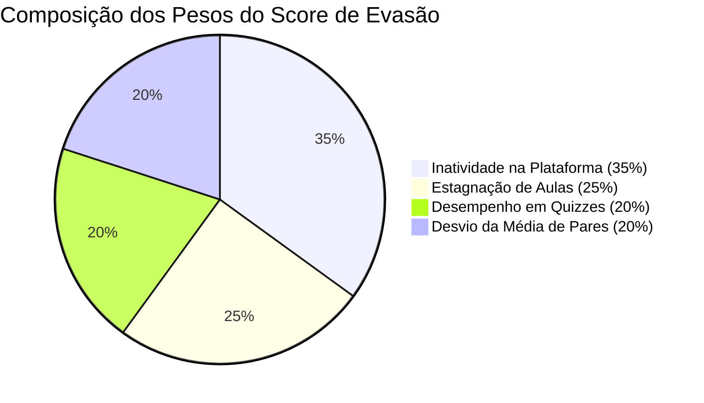
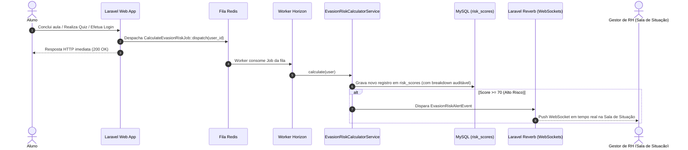

# 04. Motor de IA Anti-Evasão

## 🎯 O Diferencial Central do ALVORA

Enquanto as plataformas tradicionais de EAD apenas exibem gráficos retroativos de desistência depois que o colaborador já abandonou o curso, o **ALVORA** atua de forma preditiva. O sistema calcula continuamente a probabilidade de desistência de cada colaborador e dispara alertas e intervenções antes que a evasão se consolide.

---

## 🧮 A Fórmula do Score de Risco de Evasão (0–100)

O algoritmo matemático é implementado no [`EvasionRiskCalculatorService`](file:///c:/Users/Windows%20Lite%20BR/alvora/app/Services/EvasionRiskCalculatorService.php). Ele combina 4 dimensões de comportamento ponderadas:

$$\text{Score Total} = (0.35 \times I) + (0.25 \times E) + (0.20 \times Q) + (0.20 \times D)$$



### 1. Inatividade ($I$ - Peso 35%)
* Avalia a quantidade de dias corridos desde o último acesso registrado do aluno.
* Curva de pontuação:
  * 0 a 2 dias: 0 pts
  * 3 a 5 dias: 25 pts
  * 6 a 9 dias: 60 pts
  * 10 a 13 dias: 85 pts
  * 14+ dias: 100 pts

### 2. Estagnação ($E$ - Peso 25%)
* Avalia se o aluno continua acessando o sistema, mas **parou de avançar nas aulas**.
* Mede o delta temporal desde a última linha gravada em `lesson_progress`.
* Alunos que abrem o portal mas não concluem vídeos acumulam pontos rápidos de estagnação.

### 3. Dificuldade / Desempenho em Quizzes ($Q$ - Peso 20%)
* Calcula a nota média em todas as tentativas de quiz realizadas:
  $$\text{Quiz Factor} = \max(0, 100 - \text{Média das Notas})$$
* Alunos com notas baixas recorrentes enfrentam fricção cognitiva e desmotivação, elevando o risco.

### 4. Desvio em Relação aos Pares da Empresa ($D$ - Peso 20%)
* Compara o ritmo de conclusão do colaborador com a média de todos os outros colaboradores da mesma empresa e departamento.
* Colaboradores que ficam mais de 40% abaixo da velocidade do grupo recebem pontuação máxima de desvio.

---

## 🚦 Faixas de Classificação de Criticidade

| Faixa | Intervalo | Classificação | Comportamento do Sistema |
| :--- | :--- | :--- | :--- |
| 🟢 **Verde** | 0 – 39 pts | **Baixo Risco** | Aluno engajado, ritmo saudável. Nenhum alerta necessário. |
| 🟡 **Amarelo** | 40 – 69 pts | **Risco Moderado** | Sinais iniciais de desengajamento. Exibido na Sala de Situação como atenção. |
| 🔴 **Vermelho** | 70 – 100 pts | **Alto Risco (Crítico)** | Iminência de evasão. Disparo imediato de evento WebSocket para o RH e intervenção automática da IA. |

---

## ⚡ Fluxo de Recálculo em Background (Horizon + Redis)

O cálculo do score **nunca** bloqueia a requisição HTTP do usuário. Ele é processado de forma assíncrona pelo worker do Horizon através do job [`CalculateEvasionRiskJob`](file:///c:/Users/Windows%20Lite%20BR/alvora/app/Jobs/CalculateEvasionRiskJob.php).



---

## 🛡️ Auditoria e Explicabilidade

Cada cálculo persiste o payload JSON completo na tabela `risk_scores`:

```json
{
  "inactivity_days": 12,
  "inactivity_score": 85,
  "stagnation_days": 8,
  "stagnation_score": 60,
  "average_quiz_grade": 45.0,
  "quiz_score": 55,
  "company_avg_completion": 72.5,
  "peer_deviation_score": 80,
  "final_score": 73
}
```

Isso garante que o gestor de RH na **Sala de Situação** ([`SituationRoom.php`](file:///c:/Users/Windows%20Lite%20BR/alvora/app/Livewire/Company/SituationRoom.php)) possa clicar no colaborador e ver exatamente qual fator puxou a nota para cima (ex.: "O colaborador está há 12 dias sem entrar e tirou nota 45 no último quiz").
