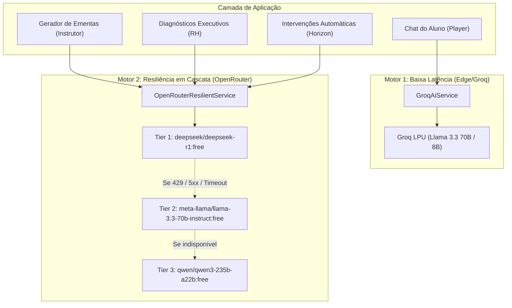

# 05. Integração com LLMs e Resiliência

## 🧠 Arquitetura Dual-Engine de Inteligência Artificial

O ALVORA não depende de um único modelo ou provedor proprietário de inteligência artificial. A arquitetura divide a carga de trabalho de IA entre dois serviços especializados:

---

## ⚡ 1. Motor de Baixa Latência: `GroqAiService`

Implementado em [`app/Services/GroqAiService.php`](file:///c:/Users/Windows%20Lite%20BR/alvora/app/Services/GroqAiService.php), este serviço atende o **Tutor de IA** em tempo real ([`AiTutorDrawer.php`](file:///c:/Users/Windows%20Lite%20BR/alvora/app/Livewire/Student/AiTutorDrawer.php)).

### Características:
* **Latência de Resposta:** Tempo médio de resposta entre 800ms e 1.4s através da infraestrutura especializada de LPUs da Groq.
* **Contextualização Dinâmica da Aula:** O system prompt recebe automaticamente:
  - Título do curso e módulo atual.
  - Título e descrição da aula que o aluno está assistindo no momento.
  - Anotações prévias do aluno.
* **Preservação de Contexto:** As mensagens do diálogo são salvas no banco de dados (`ai_conversations` e `ai_messages`), alimentando as próximas interações do aluno com memória conversacional.

---

## 🛡️ 2. Motor Resiliente em Cascata: `OpenRouterResilientService`

Implementado em [`app/Services/OpenRouterResilientService.php`](file:///c:/Users/Windows%20Lite%20BR/alvora/app/Services/OpenRouterResilientService.php), este serviço é responsável por tarefas analíticas, estruturadas e de geração de conteúdo.

### Lista de Fallback Dinâmico (Configurável via `.env`):
1. **Tier 1 — `deepseek/deepseek-r1:free`:**  
   Utilizado primariamente para tarefas de raciocínio complexo, análise de gargalos de retenção e estruturação profunda de grades curriculares.
2. **Tier 2 — `meta-llama/llama-3.3-70b-instruct:free`:**  
   Excelente adesão a instruções de formatação JSON e linguagem natural persuasiva para mensagens de intervenção ao colaborador.
3. **Tier 3 — `qwen/qwen3-235b-a22b:free`:**  
   Camada de segurança final com altíssima taxa de disponibilidade para garantir que a requisição nunca resulte em erro para o usuário final.

### Como Funciona o Algoritmo de Fallback:
1. O serviço tenta a chamada com o modelo de Tier 1 aplicando timeout estrito (15 a 30 segundos).
2. Se a chamada retornar sucesso (HTTP 200) com payload válido, o resultado é entregue imediatamente e o modelo utilizado é logado.
3. Se a API retornar **HTTP 429 (Rate Limit)**, **HTTP 502/503 (Serviço Fora)** ou esgotar o timeout:
   - Uma mensagem de aviso informativa é registrada no log da aplicação.
   - O serviço avança instantaneamente para o Tier 2 sem que o usuário perceba qualquer falha.
4. Caso o Tier 2 também oscile, o Tier 3 é acionado.

---

## 📋 Casos de Uso do Motor Resiliente

1. **Geração Inteligente de Ementas Curriculares** ([`CurriculumAiGenerator.php`](file:///c:/Users/Windows%20Lite%20BR/alvora/app/Livewire/Instructor/CurriculumAiGenerator.php)):
   - O instrutor digita um tema corporativo (ex.: *"Segurança da Informação e LGPD para Novos Contratados"*).
   - O serviço retorna um JSON estruturado contendo módulos, aulas, durações estimadas e objetivos pedagógicos prontos para serem salvos em lote no banco.
2. **Painel de Insights Executivos de RH** ([`AiExecutiveInsights.php`](file:///c:/Users/Windows%20Lite%20BR/alvora/app/Livewire/Company/AiExecutiveInsights.php)):
   - A IA consolida as notas de quizzes, inatividade geral e taxas de evasão departamentais para gerar relatórios qualitativos com sugestões práticas de ação para a diretoria.
3. **Intervenção Preditiva Automatizada** ([`EvasionInterventionService.php`](file:///c:/Users/Windows%20Lite%20BR/alvora/app/Services/EvasionInterventionService.php)):
   - Quando o colaborador entra na zona crítica (Score ≥ 70), a IA redige uma mensagem empática e personalizada, identificando o módulo onde ele parou e oferecendo incentivo direto para continuar.
