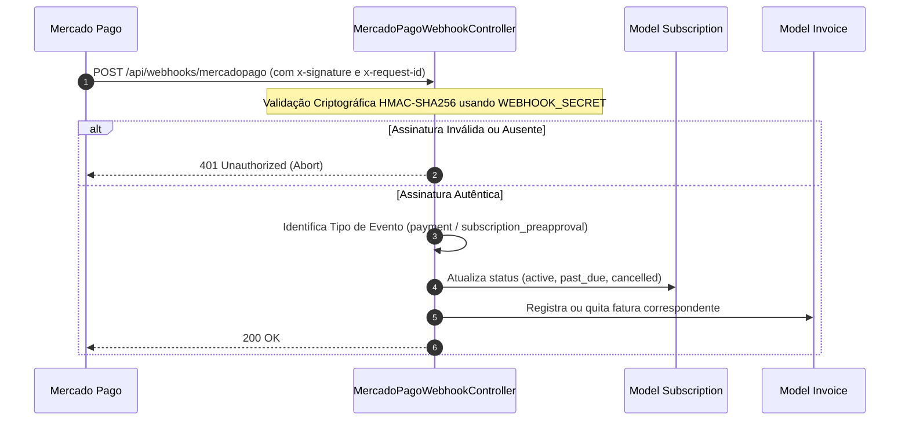
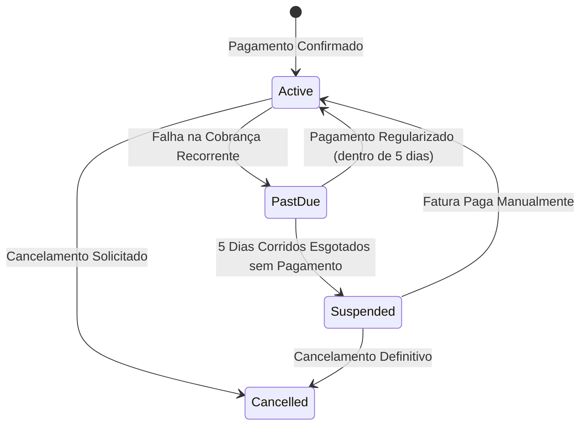

# 06. Faturamento e Assinaturas B2B com Mercado Pago

## 💳 Modelo de Cobrança e Monetização Corporativa

O ALVORA adota um modelo de **Assinatura Recorrente B2B (SaaS)**. As empresas clientes contratam planos com base em faixas de colaboradores e módulos contratados, com renovação mensal automatizada via **Mercado Pago**.

---

## 🔌 Integração: `MercadoPagoService`

Implementado em [`app/Services/MercadoPagoService.php`](file:///c:/Users/Windows%20Lite%20BR/alvora/app/Services/MercadoPagoService.php), o serviço orquestra a comunicação com a API v1 do Mercado Pago:

1. **Assinaturas Recorrentes (`/preapproval`):**
   * Cria contratos de débito automático recorrente em cartão de crédito.
   * Associa o `preapproval_id` retornado ao registro da empresa na tabela `subscriptions`.
2. **Checkout Pro (`/checkout/preferences`):**
   * Gera links de pagamento dinâmicos para adesão inicial, upgrades de plano ou quitação manual de faturas avulsas (Boleto, Pix ou Cartão).
3. **Cancelamento e Pausa:**
   * Atualiza o status do contrato diretamente na API do Mercado Pago quando solicitado pelo gestor ou administrador.

---

## 🔐 Webhooks Seguros com Validação HMAC (`x-signature`)

A integridade das notificações de pagamento é garantida em [`MercadoPagoWebhookController.php`](file:///c:/Users/Windows%20Lite%20BR/alvora/app/Http/Controllers/Api/MercadoPagoWebhookController.php) via endpoint `POST /api/webhooks/mercadopago`:

### Regra de Proteção Criptográfica:
O controlador extrai o `ts` (timestamp) e `v1` (hash) do cabeçalho `x-signature`, concatena com o `data.id` e o `x-request-id`, e calcula o hash HMAC-SHA256 utilizando o `MERCADO_PAGO_WEBHOOK_SECRET`. Se o hash calculado for divergente, a requisição é rejeitada imediatamente, impedindo ataques de injeção ou forja de pagamentos.

---

## ⏳ Ciclo de Carência e Suspensão Automática

O sistema implementa uma esteira de tolerância para proteger a experiência do cliente corporativo contra falhas temporárias de cartão de crédito:

1. **Status `active`:** Acesso irrestrito a todos os colaboradores da empresa e chamadas de IA.
2. **Status `past_due` (Carência de 5 dias):**
   * Dispara e-mail e aviso no painel do RH alertando sobre a falha no pagamento.
   * O acesso dos alunos **não é interrompido** durante esse período de cortesia para não prejudicar cronogramas de treinamento corporativo.
3. **Status `suspended` (Suspensão):**
   * Acionado automaticamente se a carência de 5 dias expirar sem quitação.
   * **Comportamento do Middleware `CheckSubscriptionStatus`:**
     * Gestores de RH são redirecionados compulsoriamente para `/instrutor/faturamento`.
     * Colaboradores e alunos são bloqueados de assistir aulas ou interagir com o Tutor IA.

---

## 📊 Dashboards Financeiros em Livewire

* **Painel da Empresa** ([`CompanyBilling.php`](file:///c:/Users/Windows%20Lite%20BR/alvora/app/Livewire/Company/CompanyBilling.php)):
  - Exibe plano ativo, data da próxima renovação e histórico completo de faturas.
  - Permite gerar segunda via de boleto/Pix ou atualizar o cartão de crédito da assinatura.
* **Painel do Super Admin** ([`AdminBilling.php`](file:///c:/Users/Windows%20Lite%20BR/alvora/app/Livewire/Admin/AdminBilling.php)):
  - Visão consolidada da receita da Alvora.
  - Cálculo dinâmico de **MRR (Monthly Recurring Revenue)** somando todas as assinaturas ativas.
  - Indicador de taxa de churn e lista de empresas com faturamento pendente.
