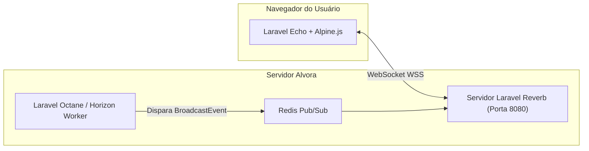
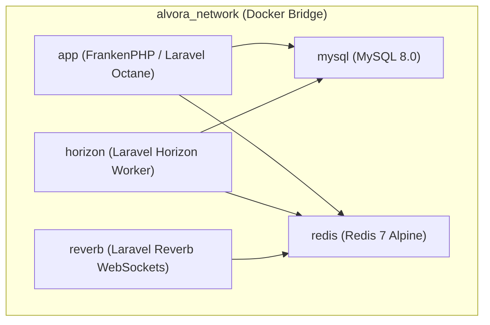

# 07. Tempo Real, Infraestrutura e Observabilidade

## 📡 WebSockets com Laravel Reverb

O ALVORA utiliza o **Laravel Reverb** como seu servidor oficial de WebSockets em tempo real. O Reverb é 100% nativo do ecossistema Laravel e compatível com o protocolo Pusher, eliminando a dependência de serviços externos pagos como Pusher Cloud ou Soketi.



### Eventos Transmitidos em Tempo Real:
* **`EvasionRiskAlertEvent`:** Transmitido no canal privado `private-company.{companyId}`. Quando o job de recálculo detecta que um aluno atingiu risco crítico (≥ 70), a Sala de Situação do RH atualiza o card e emite um alerta sonoro/visual instantâneo sem necessidade de recarregar a página (F5).
* **`NewInterventionDispatchedEvent`:** Transmitido no canal `private-user.{userId}` informando o colaborador sobre uma mensagem de apoio ou sugestão de aula.

---

## ⚙️ Filas Assíncronas com Laravel Horizon & Redis

Todas as operações pesadas (cálculo de risco de evasão, geração de ementas curriculares por IA, disparo de webhooks e compilação de PDFs) são processadas em segundo plano pelo **Laravel Horizon**:

* **Backend:** Redis 7 (In-memory com persistência RDB/AOF).
* **Supervisores de Fila:**
  - `supervisor-default`: Processamento de notificações gerais e disparos de e-mails.
  - `supervisor-evasion`: Dedicado ao recálculo concorrente de scores de evasão.
  - `supervisor-ai`: Chamadas analíticas ao OpenRouter com controle estrito de concorrência para evitar rate limits.
* **Painel Administrativo:** Acessível via rota autenticada `/horizon` para monitorar throughput, tempo de execução médio e inspeção de falhas com suporte a retentativas imediatas (*retry*).

---

## 🩺 Sonda de Saúde: Health Check API (`/api/health`)

Para integração com balanceadores de carga (AWS ALB, Nginx, Cloudflare) e orquestradores de contêineres, o sistema expõe o endpoint `/api/health`, gerenciado pelo [`HealthCheckService.php`](file:///c:/Users/Windows%20Lite%20BR/alvora/app/Services/HealthCheckService.php).

### Sondas Ativas Executadas a Cada Chamada:
1. **Banco de Dados (MySQL 8.0):** Executa uma transação de leitura rápida (`SELECT 1`) e valida se o pool PDO responde dentro de 1 segundo.
2. **Armazenamento em Cache (Redis 7):** Envia um comando `PING` e valida se o Redis retorna `+PONG`.
3. **Sistema de Arquivos (`storage/`):** Valida se o disco possui permissão de leitura/escrita e se há espaço livre superior ao limiar mínimo de segurança (500MB).

### Exemplo de Resposta Saudável (HTTP 200):
```json
{
  "status": "healthy",
  "timestamp": "2026-10-25T04:50:00Z",
  "checks": {
    "database": {
      "status": "ok",
      "latency_ms": 2.4
    },
    "redis": {
      "status": "ok",
      "latency_ms": 0.8
    },
    "storage": {
      "status": "ok",
      "free_space_mb": 42150
    }
  }
}
```
*Se qualquer serviço essencial falhar, o endpoint retorna **HTTP 503 Service Unavailable**, permitindo que o orquestrador reinicie o contêiner ou retire a instância do balanceador.*

---

## 🐳 Orquestração de Contêineres (Docker Compose)

O ambiente é orquestrado de forma totalmente declarativa através de 5 serviços em rede privada (`alvora_network`):



| Contêiner | Imagem / Base | Porta Exposta | Função |
| :--- | :--- | :--- | :--- |
| `alvora_mysql` | `mysql:8.0` | `3306` | Banco de dados transacional multi-tenant. |
| `alvora_redis` | `redis:7-alpine` | `6379` | Cache, controle de sessões e filas assíncronas. |
| `alvora_app` | Dockerfile Multi-Stage (FrankenPHP) | `8000` | Servidor web HTTP e API da aplicação. |
| `alvora_horizon` | Dockerfile Multi-Stage | - | Worker em background para processamento de filas. |
| `alvora_reverb` | Dockerfile Multi-Stage | `8080` | Servidor WebSocket para notificações em tempo real. |

---

## 🔍 Observabilidade e Rastreamento

* **Laravel Telescope:** Disponível em ambiente local e homologação para depurar queries N+1, payloads de eventos e visualização de e-mails em tempo real.
* **Sentry Integration:** Monitoramento automático de exceções não tratadas em produção, com rastreamento completo de stack trace e release tagging vinculada ao Git commit.
* **Sanitização LGPD:** O Sentry e Telescope utilizam filtros pré-configurados que nunca enviam dados sensíveis de colaboradores (senhas, documentos, respostas confidenciais de chat).
