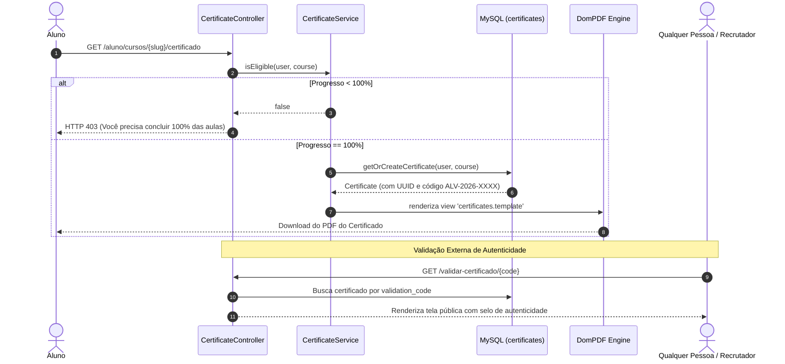

# 08. Módulo de Certificados e Validação

## 📜 Visão Geral do Módulo de Certificação

A emissão de certificados é um dos marcos cruciais de engajamento no treinamento corporativo B2B. No ALVORA, o módulo de certificados garante que colaboradores que concluam cursos corporativos recebam um documento com **validade verificável publicamente**, sem que terceiros possam fraudar o histórico.

---

## ⚙️ Arquitetura e Implementação Atual (Backend & Testes)

O backend de certificação já está implementado e validado por testes automatizados em [`tests/Feature/CertificateTest.php`](file:///c:/Users/Windows%20Lite%20BR/alvora/tests/Feature/CertificateTest.php):



---

## 🔍 Componentes do Sistema de Certificados

### 1. Modelo de Dados ([`Certificate.php`](file:///c:/Users/Windows%20Lite%20BR/alvora/app/Models/Certificate.php))
* **Isolamento Multi-Tenant:** Utiliza o trait `BelongsToTenant`, vinculando o certificado à empresa contratante (`company_id`).
* **Código de Validação Único:** Gerado no evento `creating` no formato legível:
  ```
  ALV-2026-XXXXXX (ex: ALV-2026-K92F1A)
  ```
* **UUID Imutável:** Identificador universal para links diretos e QR Codes.
* **Carimbo de Emissão:** Data e hora exatas da emissão (`issued_at`).

### 2. Regras de Elegibilidade ([`CertificateService.php`](file:///c:/Users/Windows%20Lite%20BR/alvora/app/Services/CertificateService.php))
* O método `isEligible` realiza uma consulta estrita no banco:
  - Conta o número total de aulas ativas do curso.
  - Conta quantas dessas aulas possuem registro em `lesson_progress` para aquele aluno.
  - Se a contagem de conclusões for igual ao total de aulas do curso, o aluno é considerado apto.

### 3. Geração de PDF com DomPDF
* A view [`resources/views/certificates/template.blade.php`](file:///c:/Users/Windows%20Lite%20BR/alvora/resources/views/certificates/template.blade.php) foi estilizada para renderização em folha A4 em modo paisagem (*landscape*).
* Contém: nome do colaborador, nome do curso concluído, carga horária calculada, razão social da empresa contratante, data de conclusão e código único de validação com URL pública para checagem.

### 4. Página Pública de Validação (`/validar-certificado/{code}`)
* Acessível publicamente por qualquer pessoa, sem necessidade de login.
* Se o código for legítimo: exibe um selo verde de autenticidade, confirmando os dados do aluno, curso e data de emissão.
* Se o código for inexistente ou fraudado: exibe um selo vermelho de alerta informando que o certificado não foi emitido pela plataforma Alvora.

---

## 🚀 O que Falta para o Módulo Ficar Completo? (Gap Analysis)

Embora o motor de emissão, geração de PDF e validação pública já estejam funcionando e cobertos por testes, identificamos as seguintes lacunas de produto para as próximas fases:

| Funcionalidade Pendente | Persona Impactada | Descrição do Recurso | Prioridade |
| :--- | :--- | :--- | :--- |
| **Painel "Meus Certificados"** | Aluno | Uma aba dedicada na área do aluno reunindo todos os certificados já conquistados em formato de galeria, com download direto e cópia do link de validação. | **Alta** |
| **Auditoria de Certificados pelo RH** | Gestor de RH | Tabela dentro do painel da empresa para consultar quais colaboradores concluíram cursos, data de emissão e exportar relatórios para comprovação de treinamento corporativo. | **Alta** |
| **Customização de Template** | Instrutor / RH | Possibilidade de a empresa fazer upload do logotipo corporativo, definir assinatura do responsável pedagógico e personalizar o texto do certificado. | **Média** |
| **Botão "Adicionar ao LinkedIn"** | Aluno | Link com a URL oficial da API do LinkedIn para adicionar a certificação à seção de "Licenças e Certificados" do perfil com um clique. | **Média** |
| **Disparo Automático por E-mail** | Aluno | Envio de e-mail transacional com o PDF anexado assim que o aluno conclui a última aula do curso. | **Baixa** |
